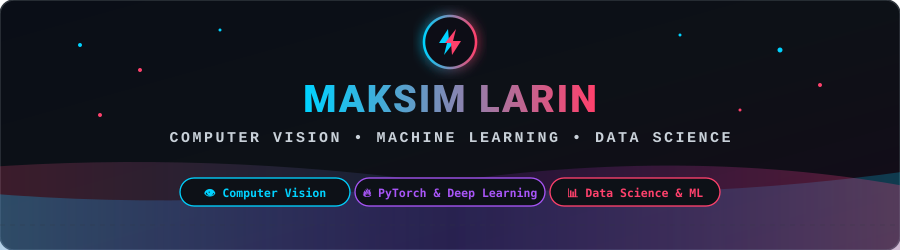

  

   

  

### ⚡ Обо мне

- 🎓 **Специализация:** Архитектура бэкенда, высоконагруженные сервисы и Full-stack разработка
- 🏆 **Главное достижение:** **🥉 3 место (Бронзовый призёр)** на всероссийском хакатоне **PostCode Challenge 2026** (система цифровой очереди Почты России)
- 💡 **Интересы:** Чистая архитектура, многопоточность в Go, Cloud Native экосистема и быстрые веб-интерфейсы
- 🌱 **Изучаю и развиваю:** Распределённые отказоустойчивые системы, Kubernetes-операторы и паттерны кэширования

### 🛠️ Стек технологий и инструменты

#### Языки программирования

#### Фронтенд

#### Бэкенд, базы данных и инфраструктура

#### Наблюдаемость и инструменты

### 📊 Активность и статистика

  
  

  

### 🚀 Избранные проекты

| Проект | Описание | Стек |
| :--- | :--- | :--- |
| 📮 [**russian-post-digital-queue**](https://github.com/Shoto373/russian-post-digital-queue) | **🥉 3 место на PostCode Challenge 2026** — Высоконагруженная система цифровой очереди Почты России: FSM реального времени, защита от долгого ожидания, K8s GitOps и ML-прогноз ETA. | `Go` `React 19` `PostgreSQL` `K3s` `ArgoCD` |
| 🌍 [**Geo-change-agent**](https://github.com/Shoto373/Geo-change-agent) | AI-агент на естественном языке для анализа спутниковых снимков: выявление вырубок, застройки и наводнений с автоматическим аудитом. | `Python` `AI` `Computer Vision` `Satellite` |
| 🎆 [**ShowFusion**](https://github.com/Shoto373/ShowFusion) | Интерактивная веб-платформа и презентационный портал для сценических спецэффектов, звука, лазеров и светового шоу. | `TypeScript` `React` `Vite` `CSS` |
| 📈 [**Study-tracker**](https://github.com/Shoto373/Study-tracker) | Персональный трекер учебной активности и продуктивности с подробной аналитикой и метриками успеваемости. | `TypeScript` `Analytics` `Productivity` |

### 📬 Связаться со мной

  
  &nbsp;
  
  &nbsp;
  

